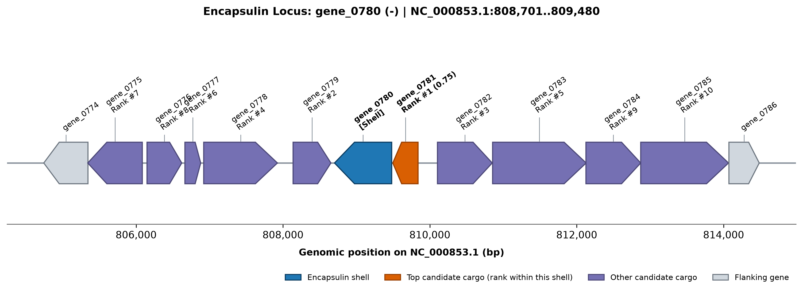

# cargofinder

A transparent, rule-based tool that ranks genes near encapsulin shell genes as candidate cargo.

This is a reproducible ranking tool, not a discovery claim. Every candidate is a hypothesis to test.

## What it does

`cargofinder` finds encapsulin shell genes in bacterial and archaeal genomes with HMMER, then scores the genes around each shell using:

1. **Position**: distance in genes, strand, and intergenic gaps.
2. **Cargo class identity**: whether the gene is a known encapsulin cargo class (DyP peroxidase, encapsulated ferritin, cysteine desulfurase, terpene cyclase and others), by Pfam profile.
3. **Targeting signal**, chosen by shell family: a C-terminal targeting-peptide consensus for Family 1, or the length of the unannotated N-terminal domain for Family 2A, which has no short targeting peptide.
4. **Terminal peptide composition**: hydrophobic and Gly/Ser content, plus optional motif regexes.
5. **Recurrence**: whether a gene family sits next to shells in several genomes (MMseqs2).

It also screens each shell locus for **prophage context**, because encapsulin shells share the HK97 fold with phage capsids and some shell hits are phage.

It writes ranked tables (TSV and JSON) with every score component, a shell table, a gene-neighborhood figure per shell, and a run summary with parameters, tool versions and profile checksums.

## Why it exists

Encapsulins enclose cargo enzymes that are often loaded through short targeting peptides. Those peptides are weakly conserved, so sequence searches alone miss cargo, and a score you cannot break down is hard to trust. `cargofinder` keeps the evidence for each candidate visible so you can judge it yourself.

### This method is not new

The genome-mining approach implemented here was established by **Andreas & Giessen (2021)**, *Large-scale computational discovery and analysis of virus-derived microbial nanocompartments* ([10.1038/s41467-021-25071-y](https://doi.org/10.1038/s41467-021-25071-y)). They searched prokaryotic genomes with HMM profiles, computed gene neighborhoods ±20 ORFs around each shell gene, and assigned Family 1 cargo by comparing nearby proteins to the targeting-peptide consensus `SDGSLGIGSLKRS` from Giessen & Silver (2017). They curated over 6,000 encapsulin-like systems and defined the family numbering this tool uses.

`cargofinder` reimplements that logic. It adds engineering and transparency, not biological insight:

1. An installable, deterministic tool with recorded tool versions and profile checksums, instead of an analysis run once.
2. A score split into named components that all appear in every output row, so a ranking can be inspected rather than trusted.
3. A benchmark against literature-curated systems that reports its own failures, including the components that turn out not to help.

**If you want a curated catalogue of known encapsulin systems, use the published datasets, not this tool.** `cargofinder` is for ranking candidates in a genome that is not in those datasets, and for seeing why each candidate ranks where it does. It makes no discovery claim.

## Install

### Pixi (recommended)

[Pixi](https://pixi.sh) installs everything, including MMseqs2:

```bash
git clone https://github.com/abakierkan/cargofinder.git
cd cargofinder
pixi install
pixi run pytest
```

Prefix the commands below with `pixi run`.

### pip

`cargofinder` is not on PyPI, so install from a clone:

```bash
pip install .
```

Runs with two or more shells also need [MMseqs2](https://github.com/soedinglab/MMseqs2) on your `PATH`.

## Quick start

```bash
# Download the shell profiles (PF04454 + PF19307), the cargo class and phage
# marker profiles, with versions and checksums recorded

cargofinder fetch-profiles --out profiles/

# Genome FASTA: genes are called with Pyrodigal
cargofinder run genome.fasta --out results/ --window 5 --tail 20

# Protein FASTA with annotation
cargofinder run proteins.faa --gff genes.gff3 --out results/

# Several genomes, so that recurrence can be measured
cargofinder run genome1.fasta genome2.fasta genome3.fasta --out results/

# Add the Family 4B profile and score both termini
cargofinder fetch-profiles --out profiles/ --extra PF08967
cargofinder run genome.fasta --profiles profiles/ --termini both --out results/

# Scan your own HMM alongside the Pfam ones. Any .hmm in the directory is used
# as a shell profile, which is the only way to cover Family 2B and Family 3.
cp my_family3.hmm profiles/
cargofinder run genome.fasta --profiles profiles/ --out results/

# Use the published targeting-peptide anchor motifs, and drop prophage loci
cargofinder run genome.fasta --out results/ \
    --motifs src/cargofinder/data/published_tp_motifs.json \
    --drop-prophage-loci
```

Outputs in `results/`:

- `candidates.tsv`, `candidates.json`: ranked candidates with all score components, plus the cargo class matched, if any.
- `shells.tsv`: detected shell genes, their E-values, and prophage-context flags.
- `run_summary.json`, `run_summary.txt`: counts, parameters, tool versions and profiles.
- `plots/neighborhood_<shell>.png`: one figure per shell.

*Thermotoga maritima* MSB8, whole-replicon run. The shell (`gene_0780`, locus `TM0785`) is blue and the top-ranked gene (`gene_0781`, locus `TM0786`, the known ferritin-like cargo) is orange. Figures show Pyrodigal gene numbers, not locus tags:



## How scoring works

The score is a weighted sum. Weights are in [default_weights.json](src/cargofinder/data/default_weights.json) and can be overridden with `--weights`.

| Component | Weight | Value |
| :--- | :---: | :--- |
| `score_distance` | 0.25 | 1.0 for the adjacent gene, falling by 1/W per gene (W = window) |
| `score_operon` | 0.15 | 1.0 likely operon, 0.5 same strand, 0.0 opposite strand |
| `score_cargo_class` | 0.30 | 1.0 for an encapsulin-cargo-specific Pfam family, 0.6 for a broad cargo-class family, 0.0 for no match |
| `score_targeting` | 0.15 | Family-aware. Family 1 shell: BLOSUM62 similarity of the terminus to the published TP consensus `SDGSLGIGSLKRS`. Family 2A shell: length of the unannotated N-terminal extension |
| `score_tail_features` | 0.05 | 0.6 × hydrophobic fraction + 0.4 × min(1, Gly/Ser fraction / 0.35); motif matches, if used, take 20% |
| `score_recurrence` | 0.10 | 0.2 for one gene, 0.6 for two, 1.0 for three or more independent genes in the cluster |

The weights are judgment calls, not fitted values. An adjacent same-strand operon gene scores 0.42 with no cargo or tail signal; recognised cargo in that position reaches about 0.72. Read the components, not just the total. See [docs/methods.md](docs/methods.md).

**Cargo class identity** is the signal the literature actually assigns cargo on — Andreas & Giessen built HMMs per cargo class and classified hits by Pfam annotation. `cargofinder` scans the same classes. Two Pfam families, PF22277 (EncFtn-like) and PF24309 (IMEF cargo Flp), are *defined* as encapsulin cargo and score 1.0; the other 13 are broad enzyme families that contain cargo among much else and score 0.6. Serine *O*-acetyltransferases and rhodaneses are excluded, because that paper says accessory operon components "are not cargo proteins".

It is weighted at 0.30 rather than higher because of two hard limits:

- **It cannot separate cargo from a co-located paralogue.** Every non-cargo class match in the benchmark was in the *P. furiosus* iron-homeostasis locus — a further ferritin-like protein and three rubrerythrins, which genuinely are that class of enzyme.
- **It only recognises cargo classes that are already known.** Novel cargo scores zero, so a candidate with no class match is *not* excluded. Never read this component as a filter.

In C-terminal mode `score_targeting` reproduces, in a small deterministic form, the comparison Andreas & Giessen (2021) made with `blastp` against the same consensus. It is not BLAST and carries no E-value or significance claim. Two things to know before reading the number:

- The consensus is itself Gly/Ser-rich, so generic Gly/Ser linkers score around 0.3 as background. The `GGSGGSGGSGG` control peptide, which Altenburg et al. (2021) showed does **not** bind the shell pocket, scores about as high as some native targeting peptides.
- It is a **Family 1** consensus, so it is only applied at Family 1 loci (see below).

**Family-aware targeting.** Families do not recruit cargo the same way, so one formula cannot serve them all. Family 1 uses a short C-terminal targeting peptide; Family 2 uses a large, disordered N-terminal domain and has no short peptide at all. `cargofinder` picks the mode from the shell's Pfam family (PF04454 → C-terminal, PF19307 → N-terminal, anything else → C-terminal as a documented fallback) and records it in the `targeting_mode` column.

For the N-terminal mode the bounds come from an experiment rather than taste: Nichols et al. (2021) found the full 225-residue *S. elongatus* CyD N-terminal domain loaded cargo best, the first 100 residues worked less well, and a 29-residue fragment did not work at all. The score is 0 at 30 residues and 1.0 at 225. The extension is measured before the *earliest* recognised domain, not the best-scoring one — otherwise a two-domain DyP peroxidase would appear to have a 140-residue extension.

This is what fixed the *S. elongatus* case: that cargo went from rank 3 to **rank 1** once it stopped being scored against a Family 1 C-terminal consensus it has no reason to match.

Anchor motifs resolved experimentally by [Altenburg et al. (2021)](https://doi.org/10.1038/s41598-021-84329-z) ship in [published_tp_motifs.json](src/cargofinder/data/published_tp_motifs.json), each quoting the sentence it came from. They are opt-in via `--motifs`, were not used for the benchmark below, and are three to six residues long, so they match many non-cargo termini by chance.

## Validation results

Run on one complete NCBI replicon for each of nine organisms, with default parameters, the default profiles (PF04454 + PF19307) and no motifs. Truth is [known_systems.tsv](validation/known_systems.tsv), matched by locus tag. The full generated output is in [validation/report.md](validation/report.md).

| Cargo recovered at rank 1 within its shell | Result |
| :--- | :---: |
| All cited, experimentally shown, separately encoded cargos | **7 / 11** |
| Those encoded next to the shell | 6 / 6 |
| Adjacent cargos, position alone (ties count against) | 5 / 6 |
| Adjacent cargos, cargo class alone | 6 / 6 |
| Adjacent cargos, targeting signal alone | 6 / 6 |
| Adjacent cargos, composition heuristic alone (ties count against) | 3 / 6 |

Cargo class and the targeting signal each rank all six known adjacent cargos first; position alone gets 5 of 6; the composition heuristic gets 3 of 6. **Six cases is still far too few to call that a result**, and several systems are related to one another. It is, however, why the composition heuristic was down-weighted and the two literature-grounded signals were brought in, and all components are reported separately so you can check them on your own data.

**Every listed shell was detected and every cargo that fell inside a window ranked first.** The four remaining misses are all distal cargo, which no neighbourhood scan can reach at any window size.

Every known cargo in a window was given a biologically correct class: the ferritin-like cargos as encapsulated ferritin, the peroxidases as DyP. Of 80 candidates scanned, 12 matched some cargo class; the non-cargo matches were all co-located ferritin-like and rubrerythrin genes in the *P. furiosus* iron locus, and adding two further genomes added none. Full table in [validation/report.md](validation/report.md) and [cargo_class_calls.tsv](validation/cargo_class_calls.tsv).

| Organism | Known cargo | Outcome |
| :--- | :--- | :--- |
| *T. maritima* MSB8 | `TM0786` Flp | Rank 1 of 10 |
| *M. tuberculosis* H37Rv | `Rv0799c` DyP | Rank 1 of 10 |
| *M. tuberculosis* H37Rv | `Rv3841` BfrB | **Missed**: outside window |
| *M. tuberculosis* H37Rv | `Rv3607c` FolB | **Missed**: outside window |
| *M. xanthus* DK 1622 | `MXAN_3557` EncB | Rank 1 of 10 |
| *M. xanthus* DK 1622 | `MXAN_4464` EncC | **Missed**: outside window |
| *M. xanthus* DK 1622 | `MXAN_2410` EncD | **Missed**: outside window |
| *R. jostii* RHA1 | `RHA1_ro02407` DypB | Rank 1 of 10 |
| *R. rubrum* ATCC 11170 | `Rru_A0973` EncFtn | Rank 1 of 10 |
| *M. smegmatis* MC2 155 | `MSMEG_5829` MsDyP | Rank 1 of 10 |
| *S. elongatus* PCC 7942 | `Synpcc7942_B2661` CyD | Rank 1 of 10 |

Failures and caveats:

- *P. furiosus* is a **false positive of the benchmark design**, not a recovery. `PF1192` ranks first, but it and `PF1191` are one 345-aa protein in PDB 2E0Z, split in two by the annotation. Notably the TP consensus signal ranks it 9th of 10, correctly declining to support the artifact that adjacency ranks 1st.
- *R. erythropolis* PR4 `RER_59910` ranks first, but it is not counted: the experiments we found used strain N771, so this row is homology-inferred.
- **False flags**: the top-3 list per shell is in [false_flags.tsv](validation/false_flags.tsv). Unconfirmed is not the same as proven non-cargo.
- **Recurrence**: pooling the genomes clusters the four DyP homologues and the two Family 2A desulfurases, but the ferritin-like cargos still do not cluster at the default thresholds despite numbering four, because they are too divergent over their length.
- **Prophage screening**: 0 of 8 true encapsulin shells were wrongly flagged, but only 2 of 9 phage capsid hits were caught, so sensitivity is weak. An unflagged locus means "not evidently prophage", never "confirmed encapsulin". The worked positive control is *M. tuberculosis* `Rv2650c` of the phiRv1 prophage.
- **Three extra encapsulin shells** were found that are not in the truth set, all by PF19307 and all annotated as encapsulin shells by RefSeq. At two of the three, the gene cargofinder ranked first is annotated by RefSeq as an encapsulin cargo protein. That is the nearest thing to a blind test here, on three cases, and it is agreement with an annotation pipeline rather than with an experiment.
- **Not blind**: parameters were not fitted to this set, but the weights and features were chosen with these systems in mind, and the composition heuristic was down-weighted after seeing it underperform here. Treat the comparison between components as optimistic.
- The set is small and related systems count more than once, so these numbers do not predict performance on new genomes. Position alone does nearly as well here.
- Only the listed replicon was scanned per organism, not whole assemblies.

Reproduce it (requires network access):

```bash
pixi run python validation/run_validation.py
```

## Assumptions and limitations

- **Targeting peptides are weakly conserved**, so motif signals are noisy.
- **Adjacency is not proof.** Some cargo is encoded elsewhere or fused to the shell, and fusions annotated as two genes can look like adjacent cargo.
- **Cargo without a recognizable terminal peptide will be missed** or get no tail credit. By default only the C-terminus is scored.
- **Novel cargo classes cannot be recognised.** `score_cargo_class` only knows the classes already in the literature, so genuinely new cargo gets nothing from the component that carries the most weight.
- **PF04454 and PF19307 are scanned by default**, covering Family 1 and Family 2; Family 4B needs `--extra PF08967`. Checked against Pfam clan CL0373 on 2026-11-26, those three are the only encapsulin-specific Pfam families; every other clan member is a phage capsid family. **Family 3 has no Pfam profile at all**: to cover it you must supply your own HMM (see Quick start). Family 2B has no Pfam entry of its own either, but PF19307 detects 2B shells in practice. PF05065 is a general phage capsid family, so expect prophage hits.
- **Targeting mode for unknown families is a guess.** Only Family 1 and Family 2A have a documented mechanism here; everything else falls back to C-terminal scoring. Check the `targeting_mode` column.
- **Shell hits can be phage.** Encapsulin shells share the HK97 fold with phage capsids, so prophage context is screened and reported, but the screen catches only some prophages (2 of 9 in the benchmark control).
- Contigs are treated as linear, so windows do not wrap around circular replicons.
- Scores from single-genome and multi-genome runs are not comparable, because recurrence is constant with one shell.

## Roadmap

- Disorder prediction for Family 2 N-terminal domains, instead of using length as a proxy.
- Targeting modes for Family 2B, 3 and 4 once their mechanisms are characterised.
- More encapsulin family profiles.
- Structure prediction and peptide-shell docking.
- Machine-learning scoring, if enough validated examples exist.
- Web UI.
- Metagenome-scale parallelization.

## How to cite

```bibtex
@software{cargofinder,
  author = {Erkan, Abdulbaki},
  title = {cargofinder: candidate cargo discovery and ranking for encapsulin nanocompartments},
  year = {2026},
  url = {https://github.com/abakierkan/cargofinder}
}
```

See [CITATION.cff](CITATION.cff).

This project was developed with AI coding assistance, and the author reviewed the methods.

## License

[MIT](LICENSE)
