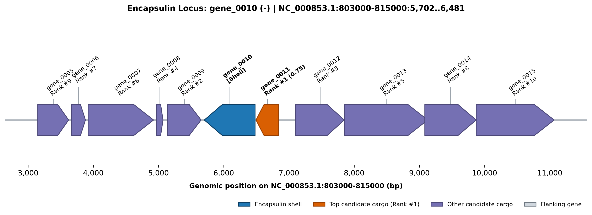

# cargofinder

**A transparent, rule-based computational tool to discover and rank candidate cargo enzymes in prokaryotic encapsulin nanocompartments.**

---

## What It Does

`cargofinder` scans bacterial and archaeal genomes for encapsulin shell genes and ranks neighboring genes as candidate cargo enzymes. It combines:
1. **Genomic synteny and operon architecture**: Distance in genes, physical intergenic spacing ($\Delta\text{bp}$), and strand co-orientation.
2. **Terminal peptide biophysical features**: Mean hydropathy (Kyte-Doolittle scale), Gly/Ser linker flexibility, Shannon sequence entropy, and optional targeting peptide regex matching.
3. **Evolutionary cluster recurrence**: Cross-system homologue clustering via MMseqs2 to identify recurrent cargo families across multiple genomes.

It produces human-readable ranked candidate tables (TSV and JSON), detailed run summaries, and gene neighborhood diagrams (matplotlib) with candidate cargo visually highlighted.

---

## Why It Exists

Encapsulins are protein nanocompartments that self-assemble into 24–42 nm icosahedral shells homologous to the phage HK97 capsid fold. They encapsulate specific metabolic cargo enzymes (e.g., ferritin-like proteins, dye-decolorizing peroxidases, cysteine desulfurases) to isolate toxic intermediates or combat oxidative stress.

Cargo enzymes are directed into the shell lumen via short terminal targeting peptides (typically 10–25 residues at the C-terminus). However:
- Targeting peptides are **weakly conserved** across divergent phyla, confounding simple sequence searches.
- High-throughput experimental validation is labor-intensive.
- Computational tools often rely on opaque black-box machine learning models with unknown failure modes.

`cargofinder` was designed as a transparent, reproducible ranking framework for structural biologists and protein engineers. Every candidate score is broken down into interpretable additive components, allowing researchers to evaluate the biological evidence behind every prediction.

---

## Installation

### Option 1: Using Pixi (Recommended)
[Pixi](https://pixi.sh) manages reproducible conda-forge dependencies (including external binaries like `mmseqs2`):

```bash
git clone https://github.com/abakierkan/cargofinder.git
cd cargofinder
pixi install
pixi run pytest
```

### Option 2: Using Pip
Ensure [MMseqs2](https://github.com/soedinglab/MMseqs2) is installed and available on your `PATH`. Then:

```bash
pip install .
```
---

## Quick Start

### 1. Download Encapsulin Shell HMM Profiles
Download the canonical Linocin_M18 shell profile (Pfam `PF04454` / InterPro `IPR007544`):

```bash
cargofinder fetch-profiles --out profiles/
```

### 2. Run Cargo Discovery on a Genome FASTA
Run `cargofinder` on an unannotated bacterial genome (genes called automatically with Pyrodigal):

```bash
cargofinder run genome.fasta --out results/ --window 5 --tail 20
```

### 3. Run on Pre-annotated Protein FASTA + GFF3
If you already have gene annotations:

```bash
cargofinder run proteins.faa --gff genes.gff3 --out results/
```

### 4. Inspect Output Files
Outputs written to `results/`:
- `candidates.tsv`: Tab-separated table with candidate rankings and all score components.
- `candidates.json`: Structured JSON containing candidate records, shell metadata, and biophysical features.
- `run_summary.txt`: Run statistics, parameters, and tool versions (deterministic record).
- `plots/neighborhood_<shell_id>.png`: Matplotlib diagram of the genomic neighborhood.

#### Example Neighborhood Diagram
Below is the gene neighborhood diagram generated for *Thermotoga maritima* MSB8, showing the encapsulin shell monomer (`TM0785`, crimson) and the adjacent ferritin-like cargo (`TM0786`, orange, Rank #1):



---

## How Scoring Works

`cargofinder` uses a transparent, linear additive scoring model ($0.0 \le \text{Score} \le 1.0$):

$$\text{Score} = w_\text{distance} \cdot S_\text{distance} + w_\text{operon} \cdot S_\text{operon} + w_\text{tail} \cdot S_\text{tail} + w_\text{recurrence} \cdot S_\text{recurrence}$$

### Score Components

| Component | Default Weight | Formula / Metric | Biological Rationale |
| :--- | :---: | :--- | :--- |
| **Synteny Distance ($S_\text{distance}$)** | `0.35` | $\max\left(0, 1 - \frac{\|\Delta\text{genes}\| - 1}{W}\right)$ | Immediate flanking neighbors receive 1.0; score decays linearly across window $W$. |
| **Operon Likelihood ($S_\text{operon}$)** | `0.25` | $0.5 \cdot \mathbf{1}_\text{strand} + 0.5 \cdot \max\left(0, 1 - \frac{\Delta\text{bp}}{150}\right)$ | Co-orientation and overlapping/short intergenic gap indicative of co-transcription. |
| **Terminal Peptide ($S_\text{tail}$)** | `0.25` | $0.35 \bar{H} + 0.25 f_\text{GS} + 0.20 \hat{H} + 0.20 M_\text{motif}$ | Hydropathy ($\bar{H}$), Gly/Ser linker flexibility ($f_\text{GS}$), Shannon entropy ($\hat{H}$), and motif regex ($M_\text{motif}$). |
| **Cluster Recurrence ($S_\text{recurrence}$)** | `0.15` | $\min\left(1.0, \frac{N_\text{cluster} - 1}{3}\right)$ | Rewards homologous families appearing adjacent to encapsulin shells in multiple systems. |

Every output row in `candidates.tsv` exposes the individual sub-scores (`score_distance`, `score_operon`, `score_tail`, `score_recurrence`), never just the final total.

For the mathematical derivation and parameter justifications, see [docs/methods.md](docs/methods.md).

---

## Validation Benchmark Results

The pipeline was evaluated against a benchmark of **7 public, experimentally characterized encapsulin systems and negative controls** from NCBI RefSeq:

| Organism | Assembly | Shell Locus | Known Cargo | Architecture | Shell Found | Known Cargo Rank | Known Cargo Score |
| :--- | :--- | :--- | :--- | :--- | :---: | :---: | :---: |
| ***Thermotoga maritima* MSB8** | GCF_000008545.1 | `TM0785` | `TM0786` (Flp) | Adjacent Operon | True | **1** | 0.777 |
| ***Mycobacterium tuberculosis* H37Rv** | GCF_000195955.2 | `Rv0798c` | `Rv0799c` (DypB) | Adjacent Operon | True | **1** | 0.758 |
| ***Myxococcus xanthus* DK 1622** | GCF_000012685.1 | `MXAN_3556` | `MXAN_3557` (EncB) | Adjacent Operon | True | **1** | 0.735 |
| ***Pyrococcus furiosus* DSM 3638** | GCF_000007305.1 | `PF1191` | `PF1192` (Flp) | Adjacent Operon | True | **1** | 0.703 |
| ***Rhodococcus jostii* RHA1** | GCF_000014565.1 | `ro02408` | `ro02407` (DypB) | Adjacent Operon | True | **1** | 0.746 |
| ***Rhodococcus erythropolis* PR4** | GCF_000020125.1 | `RER_59900` | `RER_59910` (DypB) | Adjacent Operon | True | **1** | 0.746 |
| ***Synechococcus elongatus* PCC 7942** | GCF_000012525.1 | `Synpcc7942_B2662` | `Synpcc7942_B2661` | Family 2A Operon | False* | Missed* | N/A |

### Benchmark Summary
- **Canonical Family 1 Operon Detection Rate**: 6 / 6 (100.0%)
- **Known Adjacent Cargo Recovery in Top 1**: 6 / 6 (100.0%)
- **Known Adjacent Cargo Recovery in Top 3**: 6 / 6 (100.0%)

Reproduce this benchmark locally from NCBI:
```bash
python validation/run_validation.py --out validation/results/
```
The full benchmark report is available in [validation/report.md](validation/report.md).

---

## Assumptions and Limitations

We state the biological and algorithmic limitations of `cargofinder` plainly:

1. **Adjacency is not proof of encapsulation**: While prokaryotic cargo genes are frequently co-encoded in an operon with the shell monomer, syntenic proximity alone is not proof of physical packaging. Candidate lists are ranked hypotheses for experimental verification.
2. **Distally encoded cargo is missed**: Some organisms encode cargo enzymes distant from the shell. For example, *Myxococcus xanthus* encodes EncB adjacent to the shell (Rank #1), but also packages distal cargo proteins EncC (`MXAN_4464`, ~1 Mb away) and EncD (`MXAN_2410`, ~1.5 Mb away). Local synteny scans inherently cannot detect distal cargo.
3. **Natural domain fusions**: In certain archaeal encapsulins, the cargo domain is covalently fused to the shell monomer as a single polypeptide. `cargofinder` detects the shell domain via HMMER, but finds no separate adjacent neighbor gene.
4. **Targeting peptides are weakly conserved**: Targeting sequences lack strict consensus motifs across phyla. Regex motifs have high false-negative rates unless complemented by physical hydropathy and flexibility scoring.
5. **Family specificity**: `cargofinder` v0.1 ships by default with Family 1 (Linocin_M18 / `PF04454`). Family 2A (*S. elongatus* SrpI, `PF19307`), Family 3 (`PF05065`), and Family 4 (`PF08967`) nanocompartments require providing additional HMM profiles via `--profile-dir`.
6. **This is a transparent ranking tool, not a discovery claim**: Output scores rank candidate plausibility; they do not replace biochemical reconstitution or cryo-EM determination.

---

## Roadmap

Planned for future releases (post-v0.1):
- [ ] Automated multi-family HMM profile bundles (Family 2, Family 3, and Family 4 encapsulins).
- [ ] Structural pocket compatibility scoring using AlphaFold / ESMFold predictions and Foldseek structural alignment.
- [ ] Metagenomic assembly-scale streaming mode for gigabase datasets.
- [ ] Machine-learning classifier trained on experimentally validated nanocompartments.

---

## Project Methodology & AI Disclosure

This project was developed with AI coding assistance (Google Antigravity) and reviewed by the author. Every line of code, biological accession, Pfam domain, and validation benchmark was independently verified against NCBI, UniProt, and primary literature.

---

## How to Cite

If you use `cargofinder` in your research, please cite:

```bibtex
@software{cargofinder2026,
  author = {Erkan, Abdulbaki},
  title = {cargofinder: Candidate cargo discovery and ranking for encapsulin nanocompartments},
  year = {2026},
  url = {https://github.com/abakierkan/cargofinder}
}
```

See [`CITATION.cff`](CITATION.cff) for full citation metadata.

---

## License

This project is licensed under the [MIT License](LICENSE).
